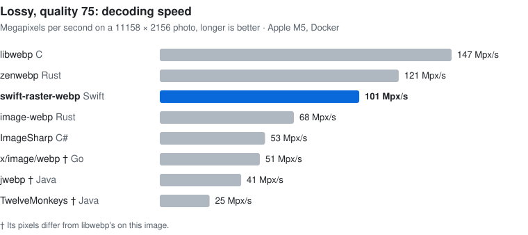
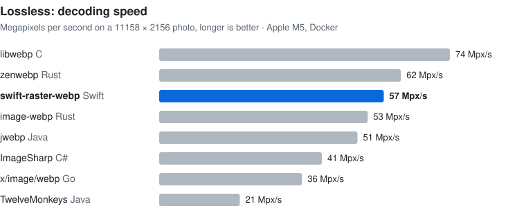
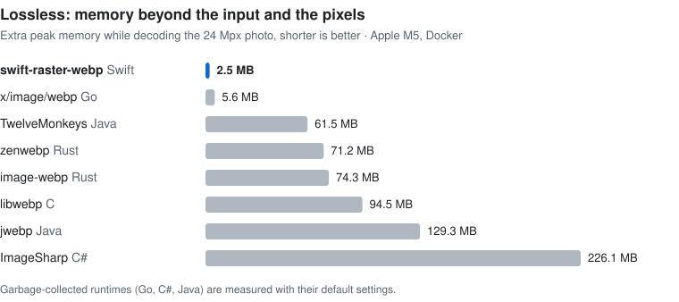

# swift-raster-webp

WebP support written entirely in Swift, with no C dependencies and no Foundation requirement.

This package is the first building block of **raster**, a planned cross-platform image library for Swift.

> [!IMPORTANT]
> **Early development.** The package decodes every kind of WebP file: lossless and lossy images, transparency and animations, and it reads ICC profiles and EXIF and XMP metadata. Encoding is not supported yet.

## Usage

Add the package to your `Package.swift`:

```swift
.package(url: "https://github.com/BZsombor/swift-raster-webp.git", from: "0.3.0")
```

```swift
.product(name: "RasterWebP", package: "swift-raster-webp")
```

Decode an image:

```swift
import RasterWebP

let image = try WebPDecoder.decode(bytes)

print(image.width, image.height)
print(image.pixels.count)    // RGBA, four bytes per pixel
```

Choose the output format and limit the resources that untrusted files can use:

```swift
var options = WebPDecodingOptions()
options.pixelFormat = .bgra8
options.alphaMode = .premultiplied
options.limits.maximumPixelCount = 50_000_000

let image = try WebPDecoder.decode(bytes, options: options)
```

Decode the frames of an animation. `WebPDecoder` returns the first frame of an animated file:

```swift
var decoder = try WebPAnimationDecoder(bytes)

while let frame = try decoder.nextFrame() {
    show(frame.image, at: frame.timestamp, for: frame.duration)
}
```

Read the properties of a file without decoding it, and its color profile and metadata:

```swift
let info = try WebPImageInfo(parsing: bytes)
print(info.width, info.height, info.compression, info.hasAlpha, info.isAnimated)

let metadata = try WebPMetadata(parsing: bytes)
print(metadata.iccProfile?.count, metadata.exif?.count, metadata.xmp?.count)
```

## Performance

Compared with every independent WebP decoder we found, on one thread, in the same Linux container on an Apple M5:

<picture>
  <source media="(prefers-color-scheme: dark)" srcset="docs/performance/charts/speed-photo-q75-dark.svg">
  
</picture>

<picture>
  <source media="(prefers-color-scheme: dark)" srcset="docs/performance/charts/speed-photo-lossless-dark.svg">
  
</picture>

<picture>
  <source media="(prefers-color-scheme: dark)" srcset="docs/performance/charts/memory-photo-lossless-dark.svg">
  
</picture>

swift-raster-webp decodes every file of the libwebp test corpus to the same pixels as libwebp, uses no platform intrinsics and checks the bounds of every memory access. See [the full comparison](docs/performance/comparison.md) for small images, binary size, macOS with Apple's ImageIO, the method and a script that reproduces it.

## Roadmap

- [x] RIFF container parsing and image properties
- [x] Lossless decoding (VP8L)
- [x] Lossy decoding (VP8) with alpha
- [x] Animation decoding, and ICC, EXIF and XMP access
- [ ] Lossless encoding, then the 1.0 release
- [ ] Lossy and animation encoding

## Requirements

- Swift 6.3 or later
- macOS 13, iOS 16, tvOS 16, watchOS 9 or visionOS 1 on Apple platforms
- Linux, Windows, Android and WebAssembly are supported targets

## Implementation

The code is written from the WebP specifications, [RFC 9649](https://www.rfc-editor.org/rfc/rfc9649.html) and [RFC 6386](https://www.rfc-editor.org/rfc/rfc6386.html). Libraries in other languages serve only as references for comparing approaches and verifying results. No code is copied or ported from them.

## Contributing

See [CONTRIBUTING.md](CONTRIBUTING.md). Please report security issues as described in [SECURITY.md](SECURITY.md).

## License

Licensed under the [Apache License 2.0](LICENSE).
