# Decoding compared with other WebP decoders

<!-- Generated by Benchmarks/Comparison/render.py from the files in results/. Edit the script, not this page. -->

swift-raster-webp is compared with every independent WebP decoder we could find in other languages: libwebp, the reference in C, two Rust crates, Go's official package, ImageSharp for .NET and two Java libraries. Wrappers around libwebp, such as Pillow or sharp, are left out, because they would measure libwebp again.

**Environment:** Apple M5, Docker, Ubuntu 24.04.5 LTS, aarch64, measured on 2026-11-22. Every library runs on one thread, in the same Linux container, with the same images.

| Library | Language | Version |
|---|---|---|
| swift-raster-webp | Swift | 0.3.0 |
| libwebp | C | 1.6.0 |
| zenwebp | Rust | 0.4.6 |
| image-webp | Rust | 0.2.4 |
| x/image/webp | Go | v0.48.0 |
| ImageSharp | C# | 3.1.12 |
| TwelveMonkeys | Java | 3.15.3 |
| jwebp | Java | 0.2.0 |

## Speed on a large photo

<picture>
  <source media="(prefers-color-scheme: dark)" srcset="charts/speed-photo-q75-dark.svg">
  
</picture>

<picture>
  <source media="(prefers-color-scheme: dark)" srcset="charts/speed-photo-q90-dark.svg">
  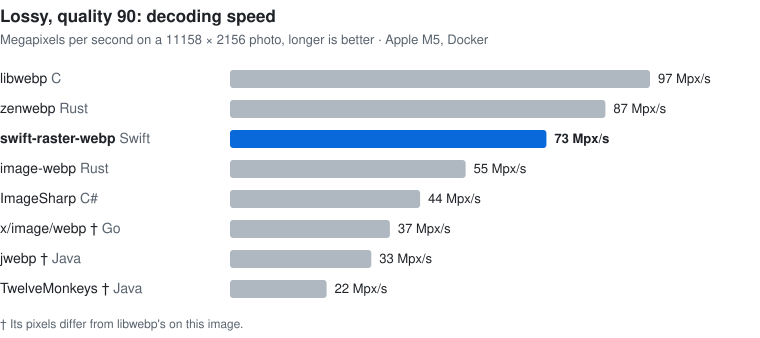
</picture>

<picture>
  <source media="(prefers-color-scheme: dark)" srcset="charts/speed-photo-alpha-dark.svg">
  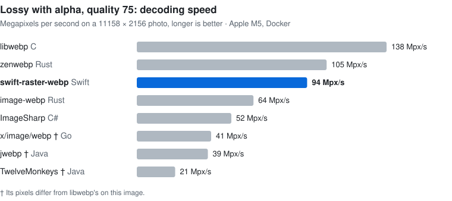
</picture>

<picture>
  <source media="(prefers-color-scheme: dark)" srcset="charts/speed-photo-lossless-dark.svg">
  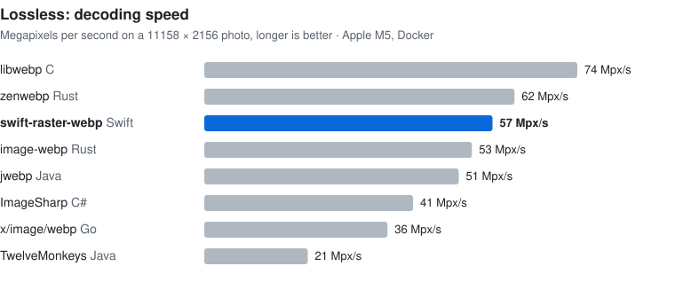
</picture>

## Time per small image

Small images show the fixed cost of every decode, which matters for icons and thumbnails.

<picture>
  <source media="(prefers-color-scheme: dark)" srcset="charts/speed-small-q75-dark.svg">
  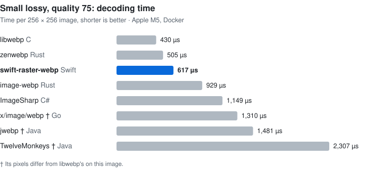
</picture>

<picture>
  <source media="(prefers-color-scheme: dark)" srcset="charts/speed-small-lossless-dark.svg">
  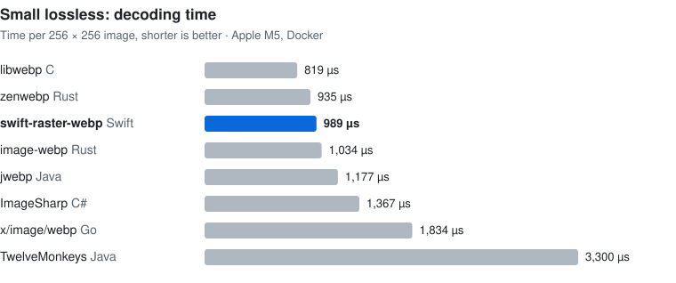
</picture>

## Memory

The extra memory is the peak memory of one decode, minus the same program's peak when it only reads the file, minus the decoded pixels themselves.

<picture>
  <source media="(prefers-color-scheme: dark)" srcset="charts/memory-photo-q75-dark.svg">
  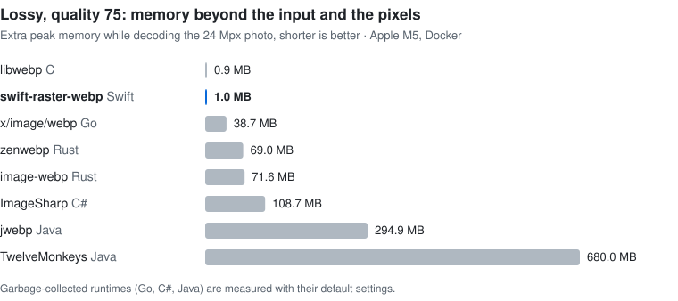
</picture>

<picture>
  <source media="(prefers-color-scheme: dark)" srcset="charts/memory-photo-lossless-dark.svg">
  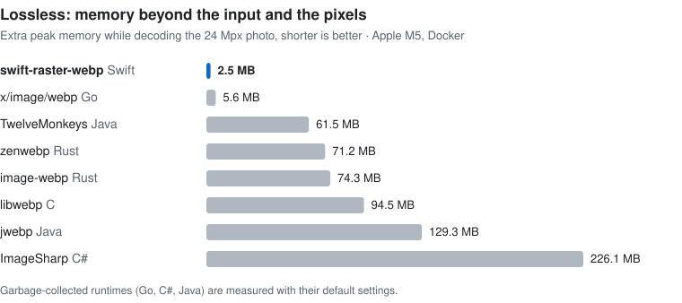
</picture>

## Binary size and correctness

<picture>
  <source media="(prefers-color-scheme: dark)" srcset="charts/binary-size-dark.svg">
  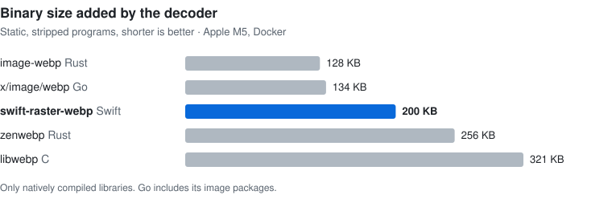
</picture>

<picture>
  <source media="(prefers-color-scheme: dark)" srcset="charts/conformance-dark.svg">
  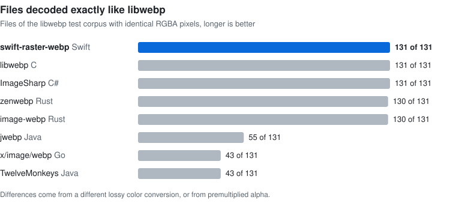
</picture>

<details>
<summary>All numbers</summary>

| Library | Lossy, quality 75 | Lossy, quality 90 | Lossy with alpha, quality 75 | Lossless | Small lossy, quality 75 | Small lossless |
|---|---:|---:|---:|---:|---:|---:|
| swift-raster-webp 0.3.0 | 100.8 Mpx/s | 73.3 Mpx/s | 93.9 Mpx/s | 57.2 Mpx/s | 617 µs | 989 µs |
| libwebp 1.6.0 | 147.5 Mpx/s | 97.3 Mpx/s | 137.8 Mpx/s | 74.1 Mpx/s | 430 µs | 819 µs |
| zenwebp 0.4.6 | 120.8 Mpx/s | 87.0 Mpx/s | 104.7 Mpx/s | 61.6 Mpx/s | 505 µs | 935 µs |
| image-webp 0.2.4 | 67.8 Mpx/s | 54.6 Mpx/s | 64.4 Mpx/s | 53.2 Mpx/s | 929 µs | 1,034 µs |
| x/image/webp v0.48.0 | 50.6 Mpx/s | 37.0 Mpx/s | 41.0 Mpx/s | 36.4 Mpx/s | 1,310 µs | 1,834 µs |
| ImageSharp 3.1.12 | 53.2 Mpx/s | 44.0 Mpx/s | 52.1 Mpx/s | 41.5 Mpx/s | 1,149 µs | 1,367 µs |
| TwelveMonkeys 3.15.3 | 25.1 Mpx/s | 22.4 Mpx/s | 21.1 Mpx/s | 20.5 Mpx/s | 2,307 µs | 3,300 µs |
| jwebp 0.2.0 | 41.1 Mpx/s | 32.7 Mpx/s | 39.2 Mpx/s | 50.5 Mpx/s | 1,481 µs | 1,177 µs |

| Library | Peak memory, lossy | Extra, lossy | Peak memory, lossless | Extra, lossless | Binary size added | Corpus files like libwebp |
|---|---:|---:|---:|---:|---:|---:|
| swift-raster-webp | 111 MB | 1.0 MB | 135 MB | 2.5 MB | 200 KB | 131 of 131 |
| libwebp | 98 MB | 0.9 MB | 214 MB | 94.5 MB | 321 KB | 131 of 131 |
| zenwebp | 166 MB | 69.0 MB | 191 MB | 71.2 MB | 256 KB | 130 of 131 |
| image-webp | 169 MB | 71.6 MB | 194 MB | 74.3 MB | 128 KB | 130 of 131 |
| x/image/webp | 137 MB | 38.7 MB | 126 MB | 5.6 MB | 134 KB | 43 of 131 |
| ImageSharp | 235 MB | 108.7 MB | 375 MB | 226.1 MB | – | 131 of 131 |
| TwelveMonkeys | 825 MB | 680.0 MB | 252 MB | 61.5 MB | – | 43 of 131 |
| jwebp | 441 MB | 294.9 MB | 320 MB | 129.3 MB | – | 55 of 131 |

Tools: Swift version 6.3.3 (swift-6.3.3-RELEASE); clang version 21.0.0 (https://github.com/swiftlang/llvm-project.git 82cdc19fa54d566969527b56f587ea8ea30bef51); rustc 1.100.0 (0ef1bc386 2026-11-09); go version go1.27.4 linux/arm64; .NET 10.0.404; openjdk version "21.0.13.1" 2026-11-17.

</details>

## On macOS, with Apple's ImageIO

Apple platforms decode WebP natively through ImageIO, so Swift developers can also compare with that. This run is separate from the Linux one, and the two are not mixed.

**Environment:** Apple M5, macOS 26.7.3, arm64, measured on 2026-11-22.

<picture>
  <source media="(prefers-color-scheme: dark)" srcset="charts/macos-speed-photo-q75-dark.svg">
  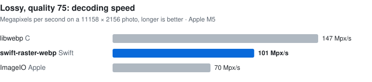
</picture>

<picture>
  <source media="(prefers-color-scheme: dark)" srcset="charts/macos-speed-photo-lossless-dark.svg">
  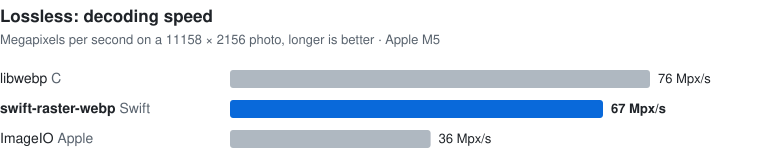
</picture>

<picture>
  <source media="(prefers-color-scheme: dark)" srcset="charts/macos-speed-small-q75-dark.svg">
  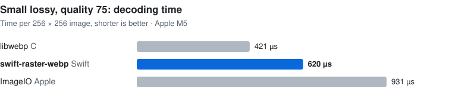
</picture>

<details>
<summary>All numbers on macOS</summary>

| Library | Lossy, quality 75 | Lossy, quality 90 | Lossy with alpha, quality 75 | Lossless | Small lossy, quality 75 | Small lossless |
|---|---:|---:|---:|---:|---:|---:|
| swift-raster-webp 0.3.0 | 101.2 Mpx/s | 74.0 Mpx/s | 93.5 Mpx/s | 67.2 Mpx/s | 620 µs | 900 µs |
| libwebp 1.6.0 | 146.9 Mpx/s | 96.8 Mpx/s | 140.2 Mpx/s | 75.7 Mpx/s | 421 µs | 874 µs |
| ImageIO macOS 26.7.3 | 70.0 Mpx/s | 46.9 Mpx/s | 66.8 Mpx/s | 36.2 Mpx/s | 931 µs | 1,940 µs |

| Library | Peak memory, lossy | Extra, lossy | Peak memory, lossless | Extra, lossless | Binary size added | Corpus files like libwebp |
|---|---:|---:|---:|---:|---:|---:|
| swift-raster-webp | 102 MB | 0.7 MB | 127 MB | 3.2 MB | – | 131 of 131 |
| libwebp | 98 MB | 1.1 MB | 214 MB | 94.9 MB | – | 131 of 131 |
| ImageIO | 293 MB | 191.9 MB | 432 MB | 308.2 MB | – | 107 of 131 |

</details>

## How it was measured

- **The images** come from `bryce.webp` of the libwebp test corpus, an 11158 × 2156 photo, encoded again with `cwebp` 1.6.0: at quality 75 and 90, with an alpha ramp, and lossless. The small images are a 256 × 256 crop of the same photo.
- **Each speed** is the median of 20 decodes from memory after 3 warm-up decodes, or of 1,000 decodes after 100 warm-ups for the small images. Every library is measured in two rounds, one after the other for all libraries, and the faster round counts, so a short disturbance of the machine cannot distort one library. The output buffer's allocation counts, the file reading does not.
- **Everyone does the same work:** WebP bytes to 8-bit pixels. swift-raster-webp, libwebp, zenwebp and ImageSharp write RGBA. image-webp writes RGB for opaque images, so its time includes expanding that to RGBA. Go returns YCbCr for lossy images, so its time includes the conversion to RGBA with `image/draw`. TwelveMonkeys returns a `BufferedImage`, and jwebp ARGB integers.
- **Pixels are checked** against libwebp. A dagger (†) marks a library whose pixels differ on that image. Go, TwelveMonkeys and jwebp convert lossy images to RGB differently from libwebp. ImageIO returns premultiplied alpha, which changes translucent pixels.
- **ImageSharp is measured at 3.1.12,** the last version that builds without a Six Labors license key. Later versions need a commercial key at build time. NuGet reports known vulnerabilities in 3.1.12, which do not matter here, because it only decodes the test images and the libwebp corpus.
- **Memory** is the peak resident memory of a separate process that decodes once, measured with `time`.
- **Binary size** is the difference between two static, stripped programs: one that only reads its argument and one that also decodes it.

## Reproducing the measurements

The script needs Docker, and on macOS also Swift and Homebrew's `webp`. Everything is built in a container or a temporary directory, which is removed at the end.

```bash
Scripts/fetch-corpus.sh
Scripts/compare-decoders.sh
```
